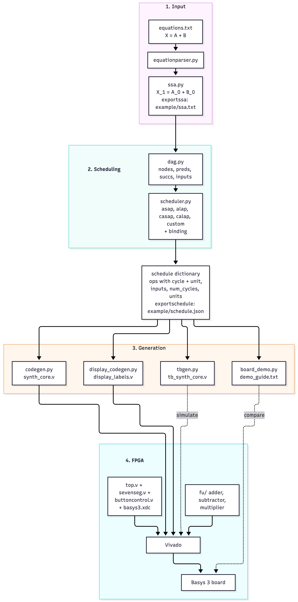
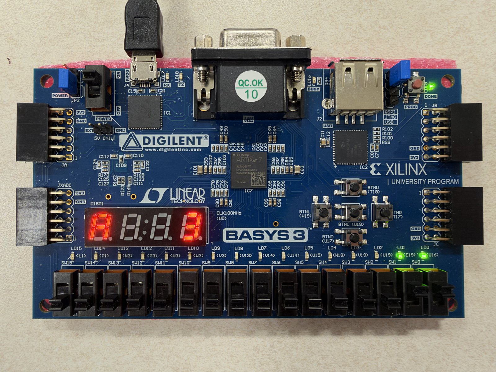
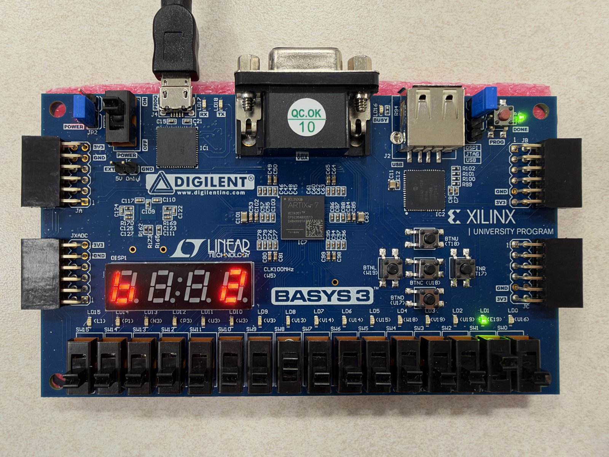
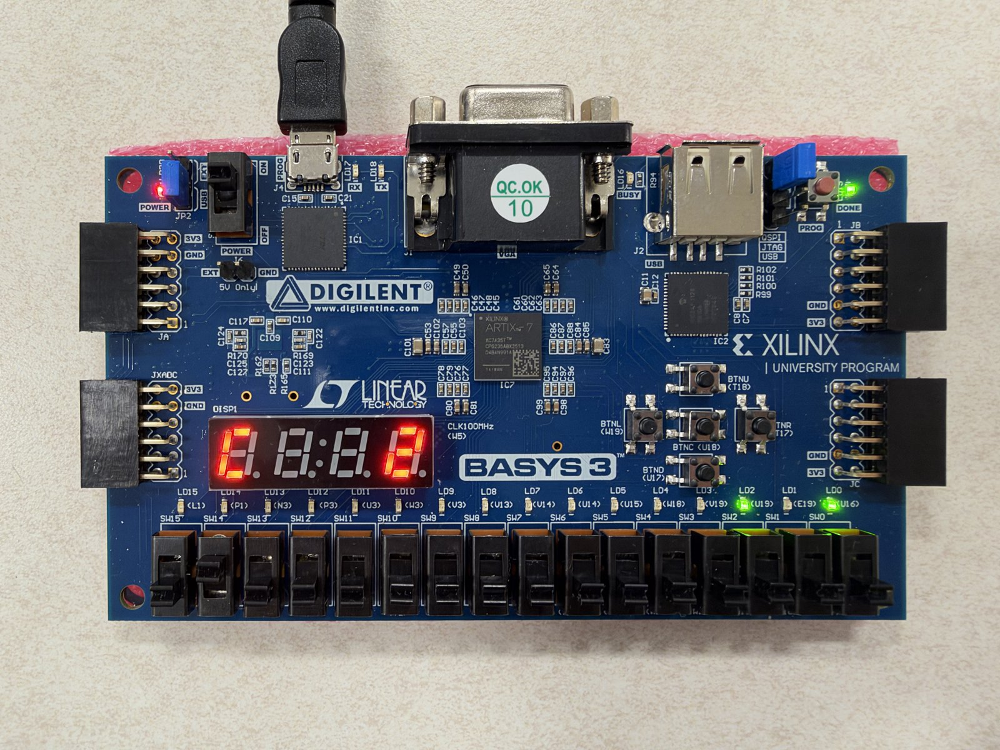
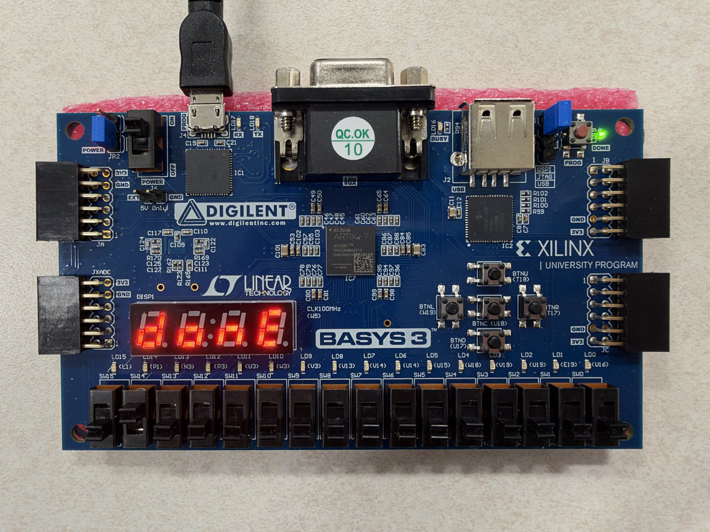

# EC551 Hardware Synthesis Tool


[](https://github.com/RichardLitt/standard-readme)

A small High-Level Synthesis (HLS) tool in Python that turns arithmetic equations into a scheduled datapath and FSM in Verilog, and runs them step by step on a Basys 3 FPGA.

This is Programming Assignment 2 ("Hardware Synthesis", Rev 2.0) for EC551,
Advanced Digital Design with Verilog and FPGAs (Boston University, Fall 2026,
Prof. Douglas Densmore). The tool reads a text file with up to 20 equations
such as `X = A + B`, and then:

- parses the equations and converts them to Single Static Assignment (SSA) form,
  which can be exported to a text file,
- builds a Directed Acyclic Graph (DAG) of the operations,
- schedules the DAG in one of five modes: ASAP, ALAP, constrained ASAP,
  constrained ALAP, or our custom mobility-priority scheduler,
- binds every operation to an adder, subtractor or multiplier,
- generates the Verilog datapath (registers, muxes, functional units) and the
  control FSM, plus a self-checking testbench,
- runs on a Basys 3 board, where a button steps the FSM one cycle at a time and
  the switches select which functional unit or register is shown.

## Table of Contents

- [Security](#security)
- [Background](#background)
- [Install](#install)
- [Usage](#usage)
  - [Input format](#input-format)
  - [Commands](#commands)
  - [Example session](#example-session)
  - [Simulation](#simulation)
- [FPGA Deployment](#fpga-deployment)
- [30-Minute Demo Plan](#30-minute-demo-plan)
- [Demo Results](#demo-results)
- [Repository Structure](#repository-structure)
- [Known Limitations](#known-limitations)
- [AI Usage](#ai-usage)
- [API](#api)
- [Maintainers](#maintainers)
- [Thanks](#thanks)
- [Contributing](#contributing)
- [License](#license)

## Security

The tool runs entirely on your own computer and never uses the network. It only
reads the equation file you give it, and only writes files into `example/`
(SSA, schedule, demo guide) and `verilog/` (generated Verilog and testbench).

## Background

Our goal was to build a complete flow from equations on paper to a circuit we
can single-step on a real FPGA, in code we can read and explain end to end. The
tool is a pipeline; every stage passes plain Python data to the next one:



### Key design decisions

- **One schedule dictionary drives everything.** `schedule()` returns the list
  of operations, each with its `cycle` and `unit` (for example `add0`), plus
  the inputs, the number of cycles and the number of units. The Verilog
  generator, the testbench generator and the demo guide all read this same
  dictionary, so they always agree. It can be exported as JSON.
- **SSA names.** A variable assigned for the n-th time is renamed `X_n`; a
  variable that is read before it is ever assigned is a primary input and is
  named `X_0`. After SSA every name has exactly one value, so dependencies are
  unambiguous.
- **DAG in topological order.** In SSA form a value is always defined before it
  is used, so the equation order is already a topological order. ASAP walks the
  list forward, ALAP walks it backward.
- **One list scheduler for all constrained modes.** Constrained ASAP,
  constrained ALAP and the custom scheduler share one function that fills one
  cycle at a time and never uses more units than allowed. They only differ in
  direction and in the priority order of the ready operations.
- **Custom scheduler: mobility priority.** Mobility is ALAP cycle minus ASAP
  cycle. When there are more ready operations than units, the one with the
  smallest mobility (the one on the critical path) goes first, so long chains
  are not delayed by operations that still have slack.
- **Binding.** Inside each cycle, operations of the same type get unit 0, 1,
  2, ... The number of units of a type is the largest number used in any one
  cycle.
- **Datapath.** One register per SSA variable. A functional unit input that
  reads different registers in different cycles gets a mux; an input with only
  one source is wired directly. This is how one adder is shared by several
  additions.
- **FSM.** State 0 is LOAD, states 1..N are the N scheduled cycles, state N+1
  is DONE. Mux selects and register write enables are decoded from the state.
  In state c the units already compute the cycle-c results; pressing the step
  button stores them and moves to state c+1 on the same clock edge.
- **Fixed ports.** `synth_core` always has the same ports, so `top.v` and the
  pin constraints never change. A new set of equations only regenerates
  `synth_core.v` and `display_labels.v`.
- **Bit widths.** Inputs are 8 bits (0-255), entered on SW7-SW0. The datapath
  is 16 bits unsigned, so results up to 65535 are shown on the LEDs and the
  display.
- **Rev 2.0 additions.** The system clock stays the 100 MHz board clock; BTNU
  is debounced into a one-clock pulse that advances the FSM by exactly one
  state, so the data is stepped by hand. The switches select which adder,
  subtractor, multiplier, result register or input is shown. Each unit also
  remembers its last result, so it can still be inspected after DONE.

## Install

Requirements:

- Python 3.8 or newer. Only the standard library is used.
- For simulation: Vivado's simulator, or Icarus Verilog
  (`brew install icarus-verilog` on macOS).
- For the FPGA part: AMD Vivado and a Digilent Basys 3 board.

```bash
git clone https://github.com/ahc9701-wq/EC551-Program-2-Demo.git
cd EC551-Program-2-Demo
```

Nothing needs to be compiled.

## Usage

Start the interactive shell from the repository folder. The equation file is
optional; it can also be loaded later with `load`. File paths are relative to
the repository folder.

```bash
python3 main.py example/examples.txt      # on Windows: python main.py ...
```

Type `help` to list the commands and `quit` to exit.

### Input format

One equation per line, at most 20 lines. Each equation has one output, two
operands and one operator (`+`, `-` or `*`). Spaces are optional.

```
X = A + B
Y = X * A
Z = Y - B
W = A * B
```

Names start with a letter or `_`. A name that is used before it is assigned
(`A` and `B` above) is a primary input and is set on the board switches.
Results are assumed to be non-negative.

### Commands

| Spec | Operation | Command |
|---|---|---|
| 1 | Load an equation file | `load <file>` |
| 1 | Show the parsed equations | `show` (`dict` prints the raw data) |
| 1 | List the primary inputs and their switch IDs | `inputs` |
| 2 | Show the SSA form | `ssa` |
| 2 | Export the SSA form to a text file | `exportssa [file]` (default `example/ssa.txt`) |
| 3 | Show the DAG | `dag` |
| 3 | Schedule | `schedule <asap\|alap\|casap\|calap\|custom> [add=N] [sub=N] [mul=N] [latency=N]` |
| 3 | Export the schedule as JSON | `exportschedule [file]` (default `example/schedule.json`) |
| 4-6 | Generate `synth_core.v` and `display_labels.v` | `verilog [file]` (default `verilog/generated/synth_core.v`) |
| 6 | Generate a self-checking testbench | `testbench [A=3 B=2]` or `tb` |
| 8 | Generate a step-by-step board checklist with expected values | `demo [A=3 B=2]` (written to `example/demo_guide.txt`) |

Scheduling modes:

| Mode | Meaning |
|---|---|
| `asap` | As soon as possible, no resource limit |
| `alap` | As late as possible. `latency=N` sets the total number of cycles (default: the ASAP latency) |
| `casap` | ASAP with at most `add=N` adders, `sub=N` subtractors, `mul=N` multipliers |
| `calap` | ALAP with the same limits |
| `custom` | Our scheduler: list scheduling where the operation with the smallest mobility goes first |

A unit type without a limit is unconstrained. `verilog`, `testbench` and
`demo` always use the most recent schedule.

### Example session

```
$ python3 main.py example/examples.txt
Loaded 4 equation(s) from examples.txt.
hls> inputs
Variable A: SW13-SW8 = 000000
Variable B: SW13-SW8 = 000001
hls> ssa
X_1 = A_0 + B_0
Y_1 = X_1 * A_0
Z_1 = Y_1 - B_0
W_1 = A_0 * B_0
hls> exportssa
SSA exported to: example/ssa.txt
hls> dag
=== DAG ===
op1: X_1 = A_0 + B_0  depends on: (inputs only)
op2: Y_1 = X_1 * A_0  depends on: op1
op3: Z_1 = Y_1 - B_0  depends on: op2
op4: W_1 = A_0 * B_0  depends on: (inputs only)
Inputs: A_0, B_0
hls> schedule asap
=== Schedule (ASAP) ===
Cycle 1: X_1 = A_0 + B_0 [add0]   W_1 = A_0 * B_0 [mul0]
Cycle 2: Y_1 = X_1 * A_0 [mul0]
Cycle 3: Z_1 = Y_1 - B_0 [sub0]
Latency: 3 cycles
Units:   1 add, 1 sub, 1 mul
hls> schedule alap
=== Schedule (ALAP) ===
Cycle 1: X_1 = A_0 + B_0 [add0]
Cycle 2: Y_1 = X_1 * A_0 [mul0]
Cycle 3: Z_1 = Y_1 - B_0 [sub0]   W_1 = A_0 * B_0 [mul0]
Latency: 3 cycles
Units:   1 add, 1 sub, 1 mul
hls> verilog
Generated display mapping: verilog/generated/display_labels.v
Verilog generated: verilog/generated/synth_core.v

FPGA INPUT MAPPING
000000 -> A_0
000001 -> B_0

FPGA OUTPUT MAPPING
00000 -> add0
00001 -> sub0
00010 -> mul0
00011 -> X_1
00100 -> Y_1
00101 -> Z_1
00110 -> W_1
00111 -> A_0
01000 -> B_0
hls> tb A=3 B=2
Testbench generated successfully!
hls> demo A=3 B=2
Demo guide saved to: example/demo_guide.txt
```

`W = A * B` does not depend on anything, so ASAP puts it in cycle 1 and ALAP
moves it to cycle 3. The multiplier `mul0` is shared by `Y_1` and `W_1`, so its
inputs go through muxes.

### Simulation

`tb` writes `verilog/testbench/tb_synth_core.v`. It loads the inputs, presses
step once per cycle and compares every functional unit output, every register
and the DONE state with a reference model. With Icarus Verilog:

```bash
iverilog -g2012 -o tb.vvp verilog/testbench/tb_synth_core.v \
    verilog/generated/synth_core.v verilog/fu/*.v
vvp tb.vvp
```

```
AUTO TESTBENCH: 2 vectors, 3 arithmetic cycles
TEST 1 INPUTS: A_0=3, B_0=2
TEST 1 PASSED
TEST 2 INPUTS: A_0=10, B_0=4
TEST 2 PASSED
ALL SYNTH_CORE TESTS PASSED (64 checks)
```

In Vivado, add the same file as a simulation source and run behavioral
simulation.

The software tests are run from the repository folder:

```bash
python3 -m tests.test_section3    # DAG, the five schedulers, binding
python3 -m tests.test_section4    # generated Verilog vs. Python results (needs iverilog)
```

`test_section4` simulates the generated circuit for the examples in all five
modes and for 40 random programs of up to 20 equations.

## FPGA Deployment

### 1. Generate the files

```
hls> load example/examples.txt
hls> schedule alap
hls> verilog
hls> tb A=3 B=2
hls> demo A=3 B=2
```

### 2. Build in Vivado

1. Create an RTL project and choose the part **xc7a35tcpg236-1**.
2. Add these design sources. Leave "Copy sources into project" unchecked, so
   Vivado picks up the regenerated files next time:
   - `verilog/top.v`, `verilog/sevenseg.v`, `verilog/buttoncontrol.v`
   - `verilog/fu/adder.v`, `verilog/fu/subtractor.v`, `verilog/fu/multiplier.v`
   - `verilog/generated/synth_core.v`, `verilog/generated/display_labels.v`
3. Add `verilog/constraintxdc/basys3.xdc` as a constraint and
   `verilog/testbench/tb_synth_core.v` as a simulation source.
4. Make sure `top` is the top module.
5. Generate Bitstream, then Open Hardware Manager -> Open Target ->
   Auto Connect -> Program Device.

For a new set of equations, only step 1 and step 5 are repeated.

### 3. Board mapping

| Board | Function |
|---|---|
| SW15-SW14 | Mode: `00` LOAD, `01` RUN, `10` VIEW |
| SW13-SW8 | LOAD: input ID (the number printed by `inputs` and `verilog`) |
| SW7-SW0 | LOAD: input value, 0-255 |
| BTNC | LOAD: store the value into the selected input |
| BTNU | RUN: advance the FSM by one state |
| BTND | Reset: clears the inputs, the results and the FSM |
| SW12-SW8, SW7, SW13 | VIEW: selector ID, bits 4-0 on SW12-SW8, bit 5 on SW7, bit 6 on SW13 |
| LD15-LD0 | LOAD: preview of the input value. RUN/VIEW: selected value in binary |
| 7-segment display | Left digit: name of the selected item. Right three digits: value in decimal |

What the display shows:

- **LOAD:** the input's letter and the value on the switches, for example `A  3` or `b  2`.
- **RUN:** `C` and the current FSM state (0 = LOAD, 1..N = cycles), then `donE`
  when the FSM reaches DONE.
- **VIEW:** the first letter of the selected variable, or `a` / `s` / `p` for
  an adder / subtractor / multiplier, and its value. A value above 999
  alternates with a second page marked `H` that shows the thousands.

Selector IDs are listed in order: functional units first, then result
registers, then inputs. The `verilog` command prints the table, it is also in
the header of `synth_core.v`, and `demo` writes the exact switch pattern and
expected LEDs for every step into `example/demo_guide.txt`.

### 4. Run a computation

1. All switches off, press BTND.
2. For each input: set its ID on SW13-SW8 and its value on SW7-SW0, press BTNC.
3. Turn on SW14 only (RUN). Press BTNU once to enter cycle 1, then once per
   cycle. After the last cycle the display shows `donE`.
4. Turn on SW15 (VIEW) and set an ID to inspect any unit, result or input.
   During RUN, switching to VIEW between presses shows the value a unit is
   computing in the current cycle.

## 30-Minute Demo Plan

The plan shows every part of the software and hardware once with a prepared
example, then runs three sets of equations written by Prof. Densmore.

Before the demo starts: the Vivado project is open with all sources added, the
board is connected and programmed with the bitstream for
`example/examples.txt` (ALAP), and a terminal is open in the repository folder.

| Time | Part | What we show |
|---|---|---|
| 0:00-2:00 | Overview | The pipeline diagram and the repository structure in this README |
| 2:00-6:00 | Software walk-through | `example/examples.txt`: `show`, `inputs`, `ssa`, `exportssa`, `dag`, then `schedule` in all five modes, `exportschedule`, `verilog`, `tb`, `demo`. We open `synth_core.v` and point out the registers, the shared `mul0` with its muxes, and the FSM |
| 6:00-9:00 | Hardware walk-through | The pre-programmed board with A=3, B=2: reset, LOAD both inputs, step with BTNU while viewing `add0` / `mul0` / `sub0`, `donE`, then VIEW X=5, Y=15, Z=13, W=6 |
| 9:00-16:00 | Live run 1 | Professor's equations, unconstrained (`asap` or `alap`) |
| 16:00-23:00 | Live run 2 | Professor's equations with resource limits (`casap` or `calap`, e.g. `add=1 mul=1`), compared with the unconstrained schedule |
| 23:00-29:00 | Live run 3 | Professor's equations with `custom`, compared with `casap` under the same limits |
| 29:00-30:00 | Wrap-up | Questions |

Each live run takes about 7 minutes:

| Step | Time | Who | What happens |
|---|---|---|---|
| 1 | 1 min | Professor / Aoke | The professor writes the equations into a text file and picks the input values (0-255) and, if he wants, the mode and limits |
| 2 | 1 min | Ian | `load`, `ssa`, `dag`, `schedule <mode> ...`, `verilog`, `tb A=.. B=..`, `demo A=.. B=..` |
| 3 | 3 min | Aoke | Generate Bitstream in Vivado and program the board |
| 3 | (same 3 min) | Ian | While Vivado builds: explain the DAG and the schedule, why each operation is in its cycle, and which units are shared. Run the generated testbench to show the expected values |
| 4 | 2 min | Both | On the board, following `example/demo_guide.txt`: reset, LOAD the inputs, step with BTNU, and VIEW the results. The professor compares the display with the expected values |

To cover every requirement across the three runs:

- Run 1 uses a variable that is assigned twice (for example `X = A + B` then
  `X = X * A`), if the professor agrees, to show the SSA renaming on hardware.
- Run 2 repeats the schedule without limits first, to show the trade-off
  between latency and the number of units.
- Run 3 shows the mobility values behind the custom schedule.

If a bitstream takes longer than planned, we show that run's testbench result
in simulation while the build finishes, and continue on the board afterwards.

## Demo Results

`example/examples.txt` on a Basys 3 with the ALAP schedule and A = 3, B = 2.
Expected results: X = 5, Y = 15, Z = 13, W = 6.

<table>
  <tr>
    <td align="center"><br>
      LOAD: input A (ID 0) = 3 on SW1 SW0, display shows <code>A  3</code></td>
    <td align="center"><br>
      LOAD: input B (ID 1 on SW8) = 2 on SW1, display shows <code>b  2</code></td>
  </tr>
  <tr>
    <td align="center"><br>
      RUN (SW14): display shows <code>C  2</code>, the FSM is in cycle 2.
      The LEDs show add0 = 5, the result of X = A + B from cycle 1</td>
    <td align="center"><br>
      RUN: all three cycles finished, display shows <code>donE</code></td>
  </tr>
</table>


The exported SSA, schedule and board checklist for this example are in
[example/ssa.txt](example/ssa.txt), [example/schedule.json](example/schedule.json)
and [example/demo_guide.txt](example/demo_guide.txt).

## Repository Structure

```
EC551-Program-2-Demo/
├── main.py                      # entry point: starts the interactive CLI
├── synthesis/
│   ├── equationparser.py        # spec 1: parse the equation file
│   ├── ssa.py                   # spec 2: SSA conversion and export
│   ├── dag.py                   # spec 3: DAG construction
│   ├── scheduler.py             # spec 3: five scheduling modes + binding
│   ├── codegen.py               # spec 4/6: datapath + FSM -> synth_core.v
│   ├── display_codegen.py       # 7-segment labels -> display_labels.v
│   ├── tbgen.py                 # spec 6: self-checking testbench generator
│   ├── board_demo.py            # board checklist with expected values
│   └── cli.py                   # interactive command shell
├── verilog/
│   ├── fu/                      # spec 5: adder.v, subtractor.v, multiplier.v
│   ├── generated/               # tool output: synth_core.v, display_labels.v
│   ├── testbench/               # tool output: tb_synth_core.v
│   ├── top.v                    # spec 6/7: top level for the Basys 3
│   ├── buttoncontrol.v          # debounce + one-pulse-per-press
│   ├── sevenseg.v               # 7-segment driver (label + decimal value)
│   └── constraintxdc/basys3.xdc # pin constraints
├── example/
│   ├── examples.txt             # demo input
│   ├── ssa.txt                  # exported SSA
│   ├── schedule.json            # exported schedule
│   └── demo_guide.txt           # generated board checklist
├── tests/
│   ├── test_section3.py         # DAG / scheduler / binding tests
│   └── test_section4.py         # simulates generated Verilog with iverilog
├── docs/
│   ├── ec551_pa2_diagram.png    # architecture diagram used in this README
│   └── demo_*.jpg               # photos of the design running on the Basys 3
└── README.md
```

## Known Limitations

- Each equation has exactly two operands and both must be variable names;
  numeric constants are not accepted by the parser.
- Arithmetic is unsigned and 16 bits wide. Results above 65535 wrap around, and
  a subtraction that would be negative wraps around as well.
- Inputs are 8 bits (0-255).
- At most 20 equations, 30 scheduled cycles, 64 inputs and 128 viewable values.
- The display label is the first letter of the variable, so `X_1` and `X_2`,
  or two variables starting with the same letter, look the same on the display.
  Their selector IDs are different and are listed by `verilog` and `demo`.
- Every SSA variable has its own register; registers are not shared.
- A new set of equations needs a new bitstream.

## AI Usage

As allowed by the course AI policy, we used generative AI tools. We reviewed
and tested this code.

- **Claude (Anthropic)**, used by Ian.
  - `synthesis/dag.py`: implements print_dag() to visualize the DAG structure, including node operations and dependencies.
  - `synthesis/codegen.py`: implements the first version of the code generation module.
  - `synthesis/scheduler.py`: develops the ALAP (As Late As Possible) scheduling algorithm, including latency constraints and node scheduling logic.
  - This README was drafted with Claude.
- **ChatGPT (OpenAI)**, used by Aoke Huang. These parts are marked `# Used AI` in
  the code.
  - `synthesis/board_demo.py`: generates the board checklist.
  - `synthesis/tbgen.py`: generates the self-checking testbench.
  - `synthesis/display_codegen.py`: generates the 7-segment label module.
  - `synthesis/cli.py`: the `demo` and `testbench` commands.

## API

The modules can also be used from Python without the CLI.

```python
from synthesis.equationparser import parseqs
from synthesis.ssa import convertssa
from synthesis.dag import build_dag
from synthesis.scheduler import schedule, print_schedule
from synthesis.codegen import write_verilog

ssa = convertssa(parseqs("example/examples.txt"))
result = schedule(build_dag(ssa), "casap", limits={"add": 1, "mul": 1})
print_schedule(result)
write_verilog(result, "verilog/generated/synth_core.v")
```

| Module | Function | Returns |
|---|---|---|
| `equationparser.py` | `parseqs(filename)` | list of `{"output", "input1", "operator", "input2"}` |
| `ssa.py` | `convertssa(equations)` | the same list with SSA names |
| `ssa.py` | `exportssa(ssaequations, filename)` | path of the written file |
| `dag.py` | `build_dag(ssa)` | `{"nodes", "preds", "succs", "inputs"}` |
| `dag.py` | `print_dag(dag)` | prints the DAG |
| `scheduler.py` | `asap(dag)`, `alap(dag, latency=None)` | `{node id: cycle}` |
| `scheduler.py` | `constrained_asap(dag, limits)`, `constrained_alap(dag, limits)`, `custom(dag, limits)` | `{node id: cycle}` |
| `scheduler.py` | `mobility(dag)` | `{node id: ALAP - ASAP}` |
| `scheduler.py` | `bind(dag, cycle)` | `({node id: unit name}, {unit type: count})` |
| `scheduler.py` | `schedule(dag, mode, limits=None, latency=None)` | `{"mode", "limits", "inputs", "num_cycles", "units", "ops"}` |
| `scheduler.py` | `print_schedule(result)`, `export_schedule(result, path)` | prints / writes JSON |
| `codegen.py` | `generate_verilog(result, width=16)` | Verilog text of `synth_core` |
| `codegen.py` | `write_verilog(result, path, width=16)` | writes `synth_core.v` and `display_labels.v` |
| `codegen.py` | `view_list(result)` | list of `(name, signal)` in selector ID order |
| `tbgen.py` | `write_testbench(schedule, path, values)` | path of the written testbench |
| `board_demo.py` | `write_demo_guide(equations, schedule, path, values)` | path of the written checklist |

`synth_core` ports:

| Port | Width | Meaning |
|---|---|---|
| `clk`, `rst` | 1 | clock and synchronous reset |
| `step` | 1 | one-clock pulse: go to the next FSM state |
| `in_sel` | 6 | which input to set |
| `in_val` | 8 | value for that input |
| `in_write` | 1 | one-clock pulse: store `in_val` (LOAD state only) |
| `fu_sel` | 7 | which unit / register `disp_val` shows |
| `disp_val` | W (16) | the selected value |
| `state` | 5 | 0 = LOAD, 1..N = cycles, N+1 = DONE |
| `done` | 1 | high in DONE |

## Maintainers

- Ian Peng ([@ianpeng-hw](https://github.com/ianpeng-hw)): DAG, scheduling,
  Verilog generation, functional units (spec sections 3-5)
- Aoke Huang ([@ahc9701-wq](https://github.com/ahc9701-wq)): parser, SSA, CLI,
  top level, testbench, FPGA deployment (spec sections 1, 2, 6, 7)

## Thanks

Thanks to Prof. Douglas Densmore for the assignment and guidance.

## Contributing

This is a course project, so we are not accepting outside contributions. Within
the team we each own separate files and merge into `main` through pull
requests.

## License

Coursework for EC551 at Boston University, Fall 2026. No open-source license is
granted; all rights reserved by the authors.
